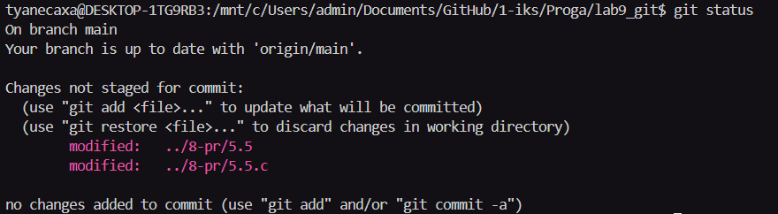
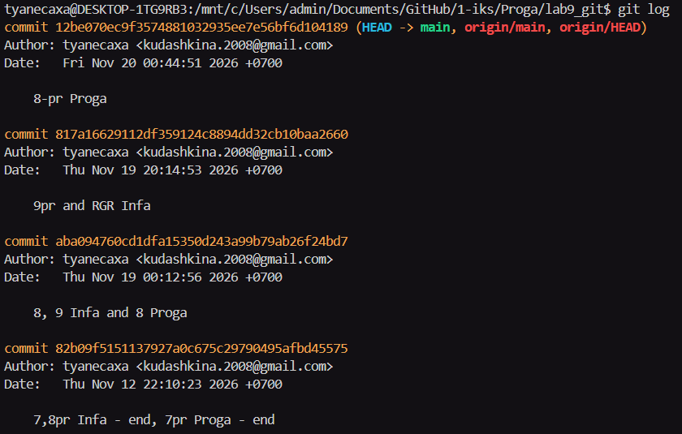
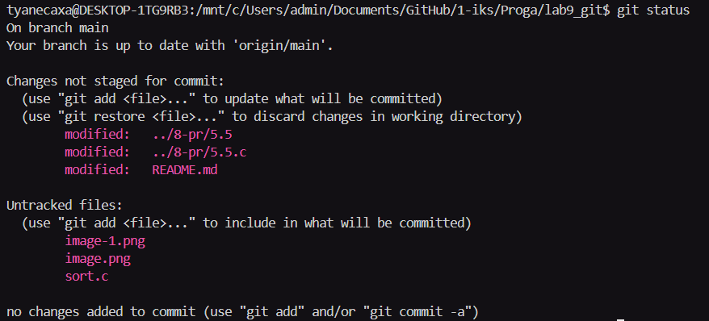
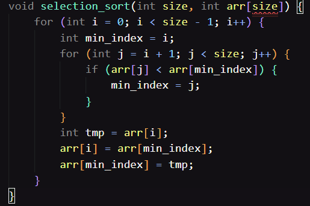

# Лабораторная работа №9
## Работа с Git

## На 3
1. Статус

2. История последних коммитов

3. 4. Создание файла sort.c. Статус

5. 6. Добавление файла в stage. Статус
 

7. 8. Коммит файла в репозиторий. Статус
 

9. 10. Статус после изменения файла

11. 12. Добавление изменения файла. Статус

13. 14. Изменяю файл еще раз. Коммит файла.

15. Статус. История коммитов.

16. Добавление и коммит изменений 

17. Пуш на удаленный репо

## Ветки.
1. 2. 3. Создаю новую ветку mybranch. Список веток. Переключение на новую ветку

4. Как изменяется `git status` после изменения ветки?
Изменяется только первая строка. 
`"On branch <name>"`

5. Точно на ветке mybranch

6. 7. Создаю файл file1.txt с текстом "Любовь". Добавляю и делаю коммит.

8. Коммит указывает на новую ветку

9. Обратно в ветку main

10. При вводе `git log --online --graph` что изменилось?

Теперь не показывается последний сделанный коммит

11. Создание файла file2.txt. Коммит

12. Посмотреть разветвление коммитов

13. Переключаемся обратно к ветке mybranch

14. Файл file2.txt пропал?
Да, так как данная ветка уже не знает об этом изменении.

15. Разница между ветками mybranch и main

